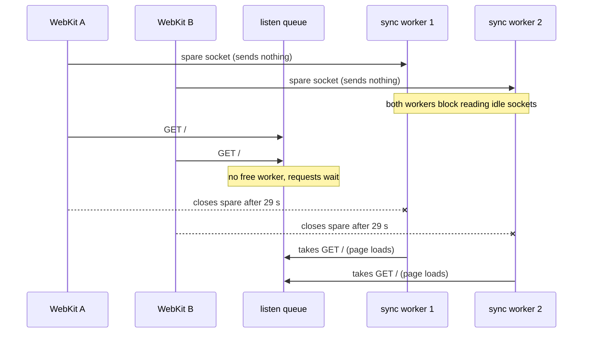
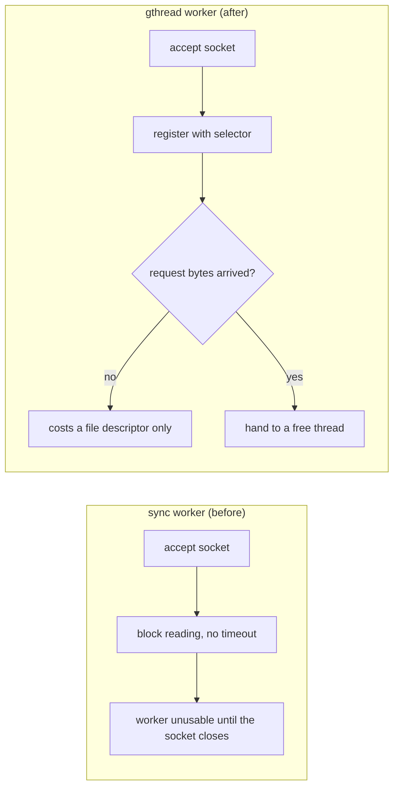

# Why webkit e2e tests timed out with parallel workers

## Summary

With more than one Playwright worker, some webkit tests timed out at 30 seconds. The cause was the app server. gunicorn ran two sync workers, and WebKit sometimes opens a spare TCP connection that stays empty until the page HTML arrives. When two WebKit browsers loaded the page together, each sync worker accepted one empty spare socket and blocked on it. The real `GET /` requests waited in the listen queue until WebKit closed the spares 29 seconds later, which left the test almost no time.

The fix is the `gthread` worker class. It hands a connection to a thread only once request bytes arrive, so idle sockets block nothing.

## Symptoms

- `npx playwright test --project=webkit --workers=5` failed once in the run recorded at handoff, then passed 7 times in a row. A script that loads the page in two WebKit browsers at the same instant stalls about half of its rounds (see Investigation, step 4).
- Each failing test timed out inside `login()` in `tests/support/desk.js`, at the `fill` of the email or password field. The call log ended at "locator resolved to `<input …>`".
- One failure screenshot was a blank white page.
- The serial suite (`workers: 1`) passed. Chromium never stalled in the two-browser script. We did not run the chromium suite in parallel.

## Investigation

### 1. The trace shows where the 30 seconds went

Both failing traces have the same timeline.

| Step | Duration |
| --- | --- |
| `page.goto('/')`, server wait for `GET /` | 29,037 ms |
| `index.js`, `index.css`, `/api/me` | under 15 ms each |
| `fill` on the email field | the remaining ~0.5 s of the 30 s budget |

The two tests ran in different worker processes, yet their `GET /` requests started in the same millisecond and got a response at the same moment. The browser connected in 1 ms, so the request reached the host and then waited. The blank screenshot is a page that never received its HTML.

The page's main thread, the actionability checks and CPU load were not the problem. The test ran out of time before `fill` could run.

### 2. A sync worker blocks on an idle socket

`backend/entrypoint.sh` started `gunicorn --workers 2` with the default sync worker. In gunicorn 23.0.0, `SyncWorker.accept()` takes a connection, makes it blocking and calls `next(parser)`, which waits for a request with no read timeout. gunicorn's design page says the sync worker "handles one request at a time per worker" and "requires a buffering proxy (nginx, HAProxy) for production" [1].

A direct test against the running app showed that two idle sockets are enough to block everything.

| Setup | `curl http://127.0.0.1:8088/` |
| --- | --- |
| Two idle TCP sockets open to :8088 | no response within 8 s |
| One of those sockets closed | 200 in 0.03 s |

### 3. WebKit opens a spare socket

A small Node TCP server logged each connection, its first bytes and its close, while Playwright's WebKit loaded a page from it.

In some loads WebKit opened connection 1, then connection 2, and sent `GET /` on connection 2. Connection 1 stayed empty until the HTML arrived, and WebKit then used it for the CSS. Chromium sent `GET /` on its first connection every time. The spare socket appears only on some loads, which is why the failure was intermittent.

To measure how long WebKit keeps an unused spare, the probe server held its `GET /` response for 60 seconds. WebKit closed the spare without sending anything 29.0 s after opening it (opened at 1,043 ms, closed at 30,068 ms). That matches the 29,037 ms stall in the traces. An Apple Frameworks Engineer gives the same figure on the Apple Developer Forums, "Safari does not reuse an HTTP/1 connection after it is idle for more than 29s" [2]. That reply is about reusing an idle connection, not spare sockets, but the idle limit is the same. gunicorn's 30-second worker timeout played no part, and the app logged no `WORKER TIMEOUT`.

### 4. The deadlock



The spares carry a request only after the HTML arrives, and the HTML needs a free worker. So N sync workers can deadlock once N or more WebKit browsers load at the same time, and a worker that ignores idle sockets never deadlocks. We tested this with a script outside Playwright's test runner.

| Server | 2 browsers | 3 browsers |
| --- | --- | --- |
| sync, 2 workers (the app as it was) | 4 of 8 rounds stalled, ~29.05 s each | not run |
| sync, 3 workers | 0 of 6 stalled | 5 of 6 stalled, ~29.07 s each |
| gthread, 2 workers with 4 threads each | 0 of 10 stalled | 0 of 10 stalled |
| Chromium against sync, 2 workers | 0 of 4 stalled | not run |

The 3-worker row matters most. Adding a worker only moves the threshold to three browsers, so the worker count was never the real fix.

### 5. Why "5 workers" meant 2

`playwright.config.js` sets `fullyParallel: false`, so Playwright gives each spec file to one worker. There are two spec files, so `--workers=5` reported "Running 11 tests using 2 workers". Two concurrent browsers was the failing count all along.

## The fix

`backend/entrypoint.sh` now runs:

```sh
gunicorn --workers 2 --worker-class gthread --threads 4 'app:create_app()'
```



In gunicorn 23.0.0, `ThreadWorker.accept()` registers each new socket with a selector and hands it to a thread only in `on_client_socket_readable()`. This behavior came from gunicorn PR #2918, where a reviewer reported that a few bare TCP connections stopped a gthread worker from answering [3]. The design page also says idle connections close after the keepalive timeout [1].

gthread has one known limit. gunicorn issue #3146 reports that a gthread worker in versions 21 to 23.0.0 freezes once its open connections exceed `worker_connections`, which defaults to 1000 per worker [5]. The issue is closed, but no release is confirmed to contain the fix. Our tests open a handful of connections, far below that limit. With 50 idle sockets open against 23.0.0, the app container stayed below 7% CPU and answered `GET /` in 5 ms.

gunicorn's docs also recommend a buffering proxy such as nginx in front of the sync workers [1][4], and it remains the safer setup for production traffic. We chose gthread because it is a one-line change with no new service. The bug also affects real users. A Safari user hits the same 29-second stall whenever spare sockets take the free workers.

## Verification after the fix

| Check | Result |
| --- | --- |
| 20 idle TCP sockets open, then `curl /` | 200 in 0.06 s |
| 2 WebKit browsers loading together, 10 rounds | 0 stalls, every load under 120 ms |
| 3 WebKit browsers loading together, 10 rounds | 0 stalls, every load under 160 ms |
| 50 idle TCP sockets open for 10 s | container CPU below 7%, `GET /` in 5 ms |
| 120 concurrent API reads as two agents, then 8 simultaneous claims of ticket 1 | 120 returned 200, exactly 1 claim got 200 and 7 got 409, no exceptions in the app log |
| `npx playwright test --project=webkit --workers=5`, 3 runs | 11 passed each time, about 8 s per run. This does not prove the fix, because the same run also passed 7 times in a row before it. |
| Frontend unit tests | 57 passed |
| Backend tests (`npm run test:backend`) | 55 passed, 100% coverage |
| Full e2e suite, serial (`npm run test:e2e`) | 33 passed |

`npm run test:all` exited 1 once, because Docker Hub timed out while Docker built the backend test image. Run separately, the backend and e2e stages both exited 0.

## What this does not change

The e2e config keeps `workers: 1`. Parallel runs are still unsafe for a separate reason. `desk.spec.js:4` expects ticket 1 to show "Unassigned" and "Assign to me", while `claim.spec.js` assigns ticket 1 at the same time. The three parallel runs above passed, but that race can still fail them. Before anyone turns on parallel runs, the claim tests need their own ticket, or the specs need ordering.

## Sources

1. gunicorn, "Design": <https://gunicorn.org/design/>
2. Apple Developer Forums, "Safari 18+ network bug - randomly - The network connection was lost", reply from an Apple Frameworks Engineer, September 2025: <https://developer.apple.com/forums/thread/796906>
3. gunicorn PR #2918, which makes gthread read a socket only when it is readable: <https://github.com/benoitc/gunicorn/pull/2918>
4. gunicorn, "Deploying Gunicorn": <https://gunicorn.org/deploy/>
5. gunicorn issue #3146, "Gunicorn gthread deadlock": <https://github.com/benoitc/gunicorn/issues/3146>
6. gunicorn 23.0.0 source, `gunicorn/workers/sync.py` (`SyncWorker.accept`, `handle`) and `gunicorn/workers/gthread.py` (`ThreadWorker.accept`, `on_client_socket_readable`), read inside the app container.
