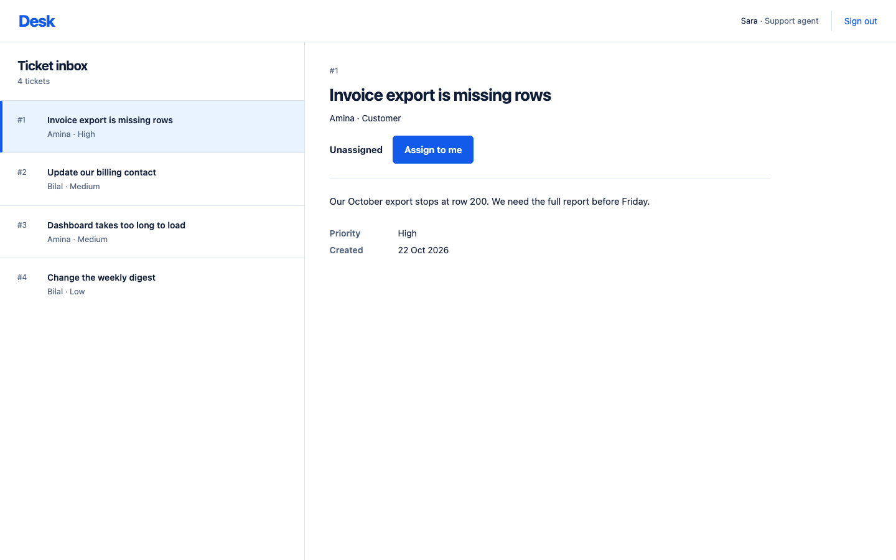
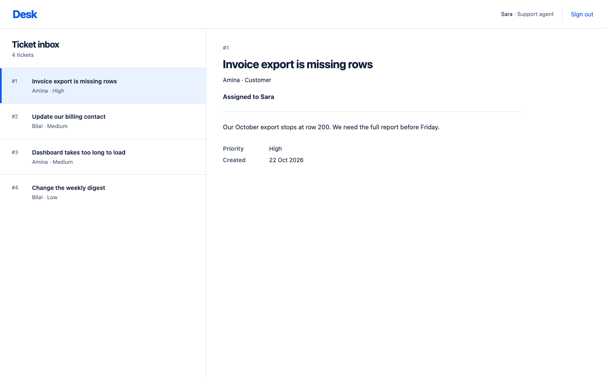
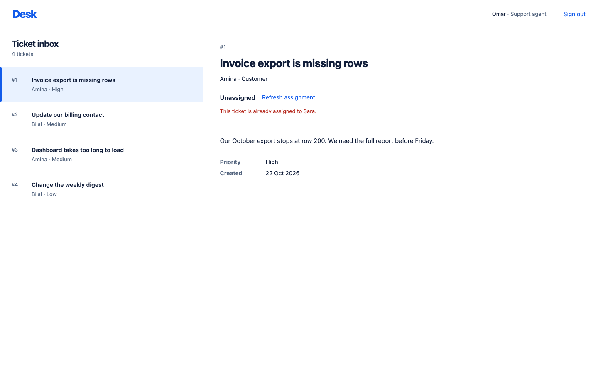
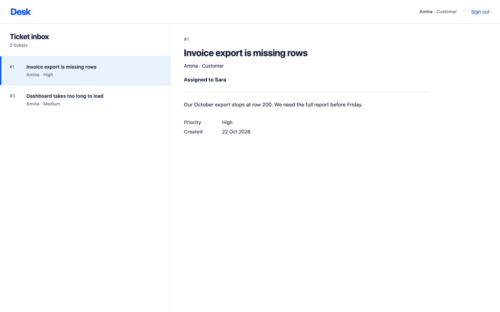
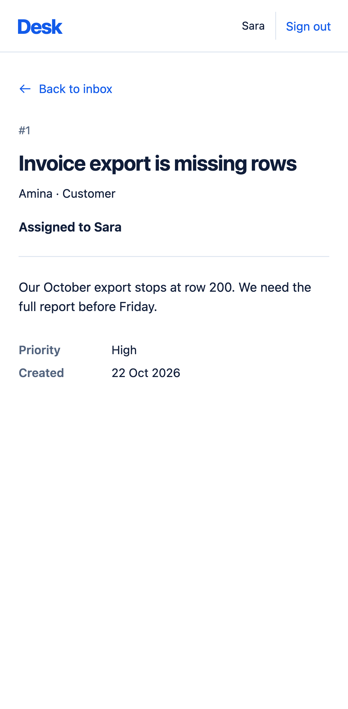

# Assign to me: a method for shipping one feature across four layers

This guide walks through how we built "Assign to me" for support tickets, from the database to a browser test. Use it as a checklist. Each section gives the method, the reason for it, and the gotchas that cost us time.

The feature has three rules. An agent can claim an unassigned ticket. Everyone sees who holds the ticket. A claimed ticket cannot be claimed again, even by the agent who holds it.

## Results

| Check | Result |
| --- | --- |
| `npm run test:all`, covering build and typecheck, frontend coverage, backend and Playwright | exit 0 |
| Frontend unit tests, run with Vitest | 57 passed, 100% statements, branches, functions and lines |
| Backend and database tests, run with pytest on a disposable PostgreSQL | 55 passed, 100% line and branch coverage |
| Playwright on chromium, webkit and mobile | 33 passed, 24 existing and 9 new |
| `npm run demo:claim` | passed in automatic mode and in the interactive, paused mode |

We lowered no coverage threshold and removed no test. We changed one existing e2e assertion. It checked that an agent sees no claim button. This feature reverses that behavior on purpose.

## The method

### 1. Write the contract before any code

Agree on the column, the response fields, the route, the status codes and the error shape, and write them down. Every layer then builds to the same contract, and a reviewer can check each diff against it.

Our contract had five parts:

- A nullable `tickets.assignee_id` that references `users(id)`. `NULL` means unassigned.
- Two response fields, `assignee_id` and `assignee`, which follow the existing `customer_id` and `customer` pair.
- The route `POST /api/tickets/:id/assign`, with no body.
- Status codes: 200 for a claim, 401 for no session, 403 for a customer, 404 for a missing ticket, and 409 when the ticket already has an assignee. The 409 applies to the same agent too.
- Errors in the existing `{ "error": "..." }` shape.

### 2. Order the commits by dependency

Each commit should read on its own, so order them so that each one only depends on the ones before it.

- Database first, because the backend tests need the column.
- Refactor next, before the feature. It keeps behavior identical, so a reviewer can check it without thinking about the feature.
- Backend after that, so the change lands in the shape the refactor prepared.
- Frontend after the API it consumes.
- Browser tests last, because they need all three layers.

### 3. Put the guarantee in one database statement

A claim must be atomic. A read followed by a write leaves a gap. Two agents can both read "unassigned" and both write. Use one conditional statement instead:

```sql
UPDATE tickets SET assignee_id = %s WHERE id = %s AND assignee_id IS NULL
```

Postgres lets exactly one statement match the row. The loser updates zero rows and gets a 409. `claim_ticket()` returns whether its call won the row.

Take the assignee from the session, never from the request. One test posts `{"assignee_id": 4}` as Sara and asserts that the ticket goes to Sara.

Check permissions before you look up the ticket. The order is 401, 403, 404, 409. A customer gets 403 for ticket 1 and for ticket 9999 alike, so the response reveals nothing about which ids exist.

Name the current assignee in the 409 message. "This ticket is already assigned to Sara." The frontend shows that text as is, so the agent knows who to contact.

### 4. Prove that a race test can fail

Start two separately logged-in sessions and post at the same moment. A barrier releases both threads together. We repeated this 15 times. Each time, exactly one request got 200, one got 409, and the row belonged to the winner.

A test that has never failed proves little. We swapped the atomic claim for a check-then-write version. Only the concurrency test failed, and the 54 sequential tests still passed. We then restored the atomic version.

### 5. Keep decision logic in a pure function

`assignmentPanel(user, ticket, claim)` in `assignment.ts` returns the label, the action to show and the message. It does not touch React. A table test covers each state: unassigned, pending, conflict, failure, assigned and customer view. The component stays thin.

Four rules shape the states:

- A 409 replaces the claim button with "Refresh assignment." The page is stale, so offering another claim would fail again. Other failures keep "Assign to me" available for a retry.
- Refresh reuses the existing `openTicket` call, so the feature adds no new fetch path.
- Disable the button while the request is pending, and relabel it "Assigning…".
- Ignore stale replies with the existing `revision` counter. A reply for a ticket the reader has already left cannot overwrite the screen. Test both the resolve path and the reject path.

For accessibility, use a native `<button>`. Put the label in a `role="status"` region and errors in a `role="alert"` region. After a successful claim, focus stays on the ticket heading. Without that, a keyboard user loses their place when the button disappears.

Customers see the assignment but never the action. The server enforces this rule too, because hiding a button is not access control.

On mobile, the section wraps, the button is at least 44px tall, and an e2e check asserts that the page has no horizontal overflow.

Adding a required prop to the shared `Ticket` type made `tsc` flag four test sites before any test ran. Let the compiler find the call sites for you.

### 6. Refactor in its own commit

After the database commit, we ran every suite to see what adding a column broke. Nothing broke, because the starter already named its columns in every `INSERT` and used an allowlist for ticket reads. We then looked for places where a future column would cause trouble, and fixed five of them in one behavior-preserving commit.

| Weakness | Fix | Why it matters |
| --- | --- | --- |
| The ticket query was copied for the list and for the detail view. The claim endpoint would have been a third copy. | `TICKET_SELECT`, `list_tickets()` and `get_ticket()` in `store.py` | A new ticket field is added in one place. |
| The "no secrets leak" test was a denylist of two column names. | The test asserts the exact key set of a ticket response. | Adding a column forces a deliberate test edit. A future `SELECT *` cannot leak a new sensitive column unnoticed. |
| Login used `SELECT *` on `users`. | The query names its columns. | The old query was safe only because the response was filtered by hand. |
| Test setup hard-coded table names in `TRUNCATE` and `DROP TABLE`. | The setup reads the table list from `pg_tables`. The "empty database" test drops and recreates the `public` schema. | A new table no longer leaks state between tests. |
| `migrate()` re-ran every file on every boot. A future non-idempotent migration would break startup. | A `schema_migrations` table records each file once. | Each migration runs once. Databases with no history adopt the schema through one idempotent re-run. |

### 7. Build e2e tests that reproduce real staleness

The conflict journey needs two real browser contexts. A single context cannot produce a stale page. Both agents must open the ticket first. Then one claims it, and the other agent's page still shows the claim button. The second context copies the project's device settings, so the mobile project really tests the mobile layout.

Reset test state through `psql`, not through a product endpoint. A reset endpoint would add attack surface that exists only for testing, and the product has no unassign feature.

Run the claim tests serially with `workers: 1`. They change rows that other tests read, and four tickets spread across three browser projects leave too few rows for parallel runs. The run took about 9 seconds before and about 31 seconds after.

Build the demo the same way as the login demo. `demo:claim` pauses at four points and resets assignments at the start and end, so it can run again. We also filtered `demo:login` to its own spec, because without the filter it would run the new demo too.

## Gotchas

- **Piping a test run hides its exit code.** We committed the backend after a run that was not green. The output went through `tail`, and `tail` exits 0. Run the suite without a pipe, or read `${PIPESTATUS[0]}`.
- **Webkit timeouts under parallel workers came from the server.** With more than one Playwright worker, some webkit tests timed out in `login()`. Load was not the cause. gunicorn ran two sync workers, and WebKit sometimes opens a spare socket that stays empty until the HTML arrives. Two browsers loading at once could occupy both workers with empty sockets, so `GET /` waited 29 seconds until WebKit closed them. The app now runs gunicorn's `gthread` worker, which ignores a socket until a request arrives. The full investigation, measurements and sources are in [docs/webkit-parallel-workers.md](docs/webkit-parallel-workers.md). The e2e config keeps `workers: 1`, because the claim tests still change a row that another spec reads.
- **A fixture that opts in leaks state.** One test left a winning assignment, and a later migration test saw it. That migration test does not use the `client` fixture. The fix is an autouse fixture that clears assignments before each test. A reset that only some tests opt into will miss the others.
- **Migrations must be idempotent.** Write `IF NOT EXISTS` in every migration. A database that predates `schema_migrations` runs each file once to adopt it, so a non-idempotent migration fails on the first boot.
- **One migration path.** The starter applied the schema in two places, the Postgres init folder and `seed.py`. We removed the init scripts from the database image, so `migrate()` is the only mechanism. Two paths drift apart.
- **Do not add `-v` when you migrate.** `docker compose down -v` deletes the database volume. To apply the migration to an existing volume, run `docker compose up -d --build`, which keeps the data. The app then runs `migrate()` on boot, and existing tickets start unassigned.
- **Keep customer lookups behind the permission check.** A 404 before the 403 would let a customer probe which ticket ids exist.
- **No framework for a small app.** The task ruled out a migration framework. A short function and a table of applied names covered the need.

## Proof

These screenshots came from a temporary Playwright spec that drove the running app. We deleted the spec after capturing the images. They live in `docs/proof/`.

### Unassigned, agent view



### Claimed by Sara



### Stale conflict



### Customer view



### Mobile, claimed



## What we verified, and what we did not

We verified persistence, the permission matrix, the 409 conflict, concurrent claims, refresh behavior, keyboard activation, the mobile layout, the existing login, logout, inbox and detail flows, and the interactive demo. We also verified migration of an existing volume. We restarted the app against a database whose column had been dropped. It came back with all 4 tickets intact and unassigned.

We did not verify these things.

- The Render deployment. It runs the same `seed()` and `migrate()` at startup, so it should behave the same way, but we never ran it against a real Render database.
- A truly simultaneous double-click in a browser. The pytest race test covers the same guarantee at the HTTP and database level. A simultaneous-click Playwright test would be flaky by design.

## Known gaps

`GET /api/tickets` still returns every ticket to customers, and the frontend filters the list. This predates the feature and is out of scope. It is the most important follow-up.

Unassign, reassign and resolution are out of scope for this task.

## How to run it

```sh
docker compose up -d --build --wait   # the app on http://127.0.0.1:8088
npm install
npm run test:all                      # build, frontend coverage, backend, Playwright
npm run demo:claim                    # paused walkthrough (DESK_DEMO_AUTO=1 for no pauses)
```

To apply the migration to an existing database volume, run `docker compose up -d --build`. Do not add `-v`.
